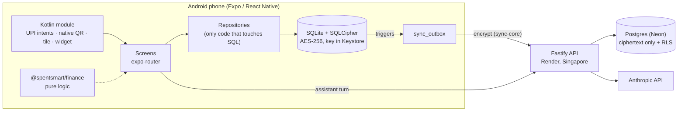

<p align="center">
  
</p>

<h1 align="center">SpentSmart</h1>
<p align="center"><strong>A local-first, privacy-first expense tracker for UPI India.</strong><br/>
Your money data lives in an encrypted database on your phone. The optional cloud backup is end-to-end encrypted:
the server stores ciphertext it cannot read.</p>

---

## What it does

| | |
|---|---|
| **Pay and log in one step** | Scan any UPI QR. Shops are paid through a direct UPI intent with the result read back. Friends' personal UPI IDs are paid by handing Google Pay a QR drawn on the phone (UPI apps refuse intent payments to personal IDs). Every payment is recorded once, idempotently. |
| **Log without typing** | Quick add understands phrases like `swiggy 340 dinner #office` or `salary 50k yesterday` (99.6% on 255 phrases, 95% on a blind set) and learns your categories. There's also voice, receipt OCR, bank statement import, a Quick Settings tile and a home-screen widget (Add / Speak / Scan & pay). |
| **Know where you stand** | Safe-to-spend until payday, budgets, goals, accounts and transfers, plus insights: recurring payments, month-end forecast with its reasoning, and anomalies. |
| **Optional sync and backup** | Google sign-in, XChaCha20-Poly1305 end-to-end encryption, a recovery key only you hold, three-way merge across phones. |
| **Optional assistant** | Ask "am I within budget?" with **your own Gemini key** (a free one works). The phone calls Google directly; the model calls tools that run **on your phone** and only sees the figures it asked for, never payee names or notes unless you allow them. Changes are proposals you confirm. |

Everything beyond the core app is **off until you switch it on**. The in-app privacy policy says exactly what each
feature reads and keeps.

## Architecture at a glance



A monorepo with one rule that matters most: **business logic is pure TypeScript in `packages/`, shared by the app
and the server and tested without a device.**

```
apps/
  mobile/            Android app: Expo SDK 54, React Native 0.81, expo-router 6, Hermes
    app/             screens (thin: read with hooks, write through repositories)
    db/              driver, migrations (v1–v4), repositories, SQLCipher key handling
    services/        side effects: payments, cloud sync, export, voice/OCR
    modules/upi-intent/  Kotlin Expo module: UPI intents, ZXing QR, Quick Settings tile, home widget, Save-as
    plugins/         Expo config plugins (cleartext for the local API, ML Kit model)
    .maestro/        end-to-end flows for the emulator
  api/               Fastify + Postgres sync server and assistant proxy (see apps/api/README.md)
packages/
  finance/           money (integer paise), UPI parse/build/response, periods, reports, quick add, insights,
                     statement/receipt import
  sync-core/         XChaCha20-Poly1305 + HKDF key wrapping, sync contracts, three-way record merge
  assistant/         tool definitions, the tool loop, amount traceability check, 50-question eval set
```

Deeper reading:

| Doc | What's in it |
|---|---|
| [docs/ARCHITECTURE.md](docs/ARCHITECTURE.md) | Layers, data model, encryption, sync engine, security model |
| [docs/UPI-INTEGRATION.md](docs/UPI-INTEGRATION.md) | What UPI apps accept from another app, field-test results, the payment routes |
| [docs/adr/0001-end-to-end-encrypted-sync.md](docs/adr/0001-end-to-end-encrypted-sync.md) | Why and how sync is end-to-end encrypted |
| [docs/DEV-LOOP.md](docs/DEV-LOOP.md) | Emulator, dev client, Metro, local API, Maestro |
| [docs/RELEASING.md](docs/RELEASING.md) | EAS profiles, and building a signed release APK locally |
| [apps/api/README.md](apps/api/README.md) | Server: endpoints, environment, Render + Neon deploy |
| [PRIVACY.md](PRIVACY.md) | The privacy policy (same text as Settings → Privacy policy) |
| [docs/v2/PLAN.md](docs/v2/PLAN.md) | v2 roadmap and phase status |

## Privacy, concretely

- **On the phone:** SQLCipher (AES-256) with a random key in the Android Keystore. Android Auto Backup is off.
- **No analytics, no ads, no trackers.** Diagnostics stay on the phone (last 20 crashes, with amounts, UPI IDs and emails redacted).
- **Sync:** the server sees your Google account ID, email, device names and record counts and sizes. It never sees amounts, payees, notes, categories or dates.
- **Permissions are trimmed:** photo picker only, contact *writing* blocked, draw-over-apps blocked. No SMS or notification-access permission.

## Quick start

Needs Node 22, pnpm 10, JDK 17 and the Android SDK. The app uses native modules and SQLCipher, so it **doesn't run
in Expo Go**; use a development build.

```bash
pnpm install
pnpm check                                   # typecheck + lint + tests in every package (what CI runs)

# the app, on an emulator or phone
cd apps/mobile && npx expo run:android       # builds and installs a development build, starts Metro

# the sync server with an in-process Postgres (PGlite), test sign-in and a fake assistant model
pnpm --filter @spentsmart/api dev:local      # http://127.0.0.1:3000
```

The full emulator loop (dev client, local API, Maestro, fake bank SMS) is in [docs/DEV-LOOP.md](docs/DEV-LOOP.md).

## Testing

| Layer | How |
|---|---|
| Pure logic | Vitest in `packages/*`: money, UPI, periods, insights, quick add, crypto, merge, assistant tools |
| App data layer | Vitest against Node's SQLite with the real migrations and repositories (`apps/mobile/db/*.test.ts`) |
| Server | Vitest against PGlite: auth, keys, push/pull, cross-user isolation, account deletion |
| End to end | Maestro flows in `apps/mobile/.maestro` on the emulator |
| CI | `.github/workflows/ci.yml`: typecheck, lint, tests, an Android export, and a production-dependency audit |

642 tests pass on `v2/assistant`.

## Builds

`eas build -p android --profile preview` makes an installable APK that points at the live server. When the
EAS quota runs out, the same signed APK can be built locally; see [docs/RELEASING.md](docs/RELEASING.md).

## License

MIT, see [LICENSE](LICENSE).
