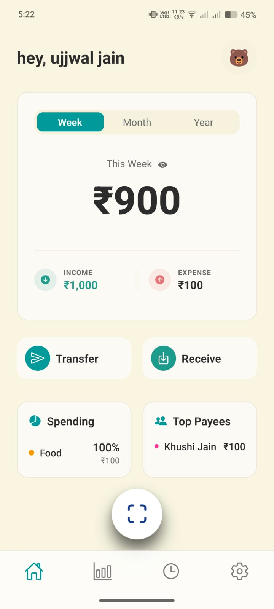
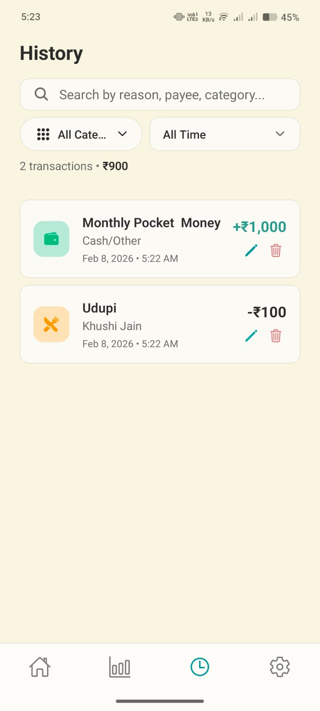
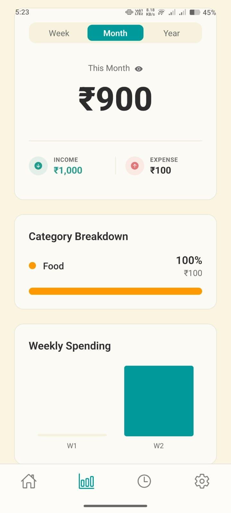

<p align="center">
  
</p>

<h1 align="center">SpentSmart</h1>
<p align="center"><strong>Private UPI expense tracker for Android</strong></p>

SpentSmart logs your UPI spending without reading your SMS, linking your bank, or sending anything to a server.
You scan a QR (or type a payee), pay in your own UPI app, and confirm the result. Everything stays in an
encrypted database on your phone.

## How it works

1. Scan a UPI QR code, or add a payee by hand.
2. SpentSmart opens your UPI app (PhonePe, Google Pay, Paytm, BHIM…) with the payment filled in and waits for
   the app's answer.
3. If the app reports success or failure, that is pre-selected; otherwise you are asked. You confirm once and
   the payment is recorded. If the app is killed while you pay, the payment waits on Home until you confirm it.

The UPI app's answer is a strong hint, not proof (there is no server to verify it), so you always have the
last word. Details and limits: [docs/UPI-INTEGRATION.md](docs/UPI-INTEGRATION.md).

## Features

* QR scan, manual entry, receive-money QR
* Categories (custom icons and colours), search, filters, edit/delete
* Week / month / year insights, trends, monthly budget
* App lock (biometric or device passcode), privacy mode, screenshot blocking while locked
* CSV and PDF export (created on the device, deleted after sharing)
* Optional daily reminders (off by default)
* Light / dark / system themes

## Privacy at a glance

* No account, no analytics, no ads, no SpentSmart server.
* Data is stored in SQLCipher (AES-256); the key lives in the Android Keystore.
* Camera only while scanning. Contacts only when you tap "Pick contact", and only that one name is read.
* The clipboard, SMS and location are never read.
* The one network use is Expo's app-update check, which does not include your data.

Full policy: [PRIVACY.md](PRIVACY.md). You can see what is stored in **Settings → Privacy dashboard**.

## Demo

| Home | History | Analytics |
|:---:|:---:|:---:|
|  |  |  |

*Screenshots predate the latest UI pass and may differ slightly.*

## Getting started

Requires Node 22+, JDK 17+ and the Android SDK. The app uses a custom native module and SQLCipher, so it
**does not run in Expo Go**; use a development build.

```bash
git clone https://github.com/Ujjwaljain16/SpentSmart.git
cd SpentSmart
npm ci
npx expo run:android        # builds and installs a development build
```

### Scripts

| Command | What it does |
|---|---|
| `npm run check` | typecheck + lint + tests (what CI runs) |
| `npm test` | unit tests (domain, database, payment launcher, reports) |
| `npm run typecheck` | `tsc --noEmit` |
| `npm run lint` | ESLint (no `console`, no `any`) |

### Release builds

```bash
eas build --platform android --profile preview      # installable APK
eas build --platform android --profile production   # Play Store bundle
eas update --channel preview --message "what changed"
```

Bump `version` in `app.json` whenever native code or config changes; OTA updates are scoped by it.

## Project layout and design

See [docs/ARCHITECTURE.md](docs/ARCHITECTURE.md). The October 2026 review that drove the current design is in
[docs/AUDIT-2026-10.md](docs/AUDIT-2026-10.md).

## License

MIT, see [LICENSE](LICENSE).
