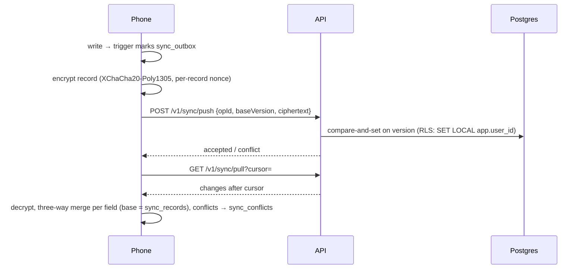

# Architecture

SpentSmart is an Android app (Expo SDK 54, React Native 0.81, Hermes) backed by an optional sync server. The
phone is the source of truth. The server is a mailbox for encrypted records, plus a narrow proxy for the assistant.

## Monorepo

pnpm workspaces + Turborepo. `pnpm check` runs `typecheck`, `lint` and `test` in every package, which is what CI runs.

| Package | Runs on | Responsibility |
|---|---|---|
| `packages/finance` | phone + server | Money as integer paise, UPI URI parse/build/response, periods, reports, safe-to-spend, quick-add parser, insights detectors, statement/receipt/export parsing, the capture text parser. No I/O. |
| `packages/sync-core` | phone + server | Envelope encryption (XChaCha20-Poly1305, HKDF), sync wire contracts (zod), three-way record merge. |
| `packages/assistant` | phone + server | Tool definitions and their implementations over the ledger, the tool loop, the amount-traceability check, evals. |
| `apps/mobile` | phone | Screens, SQLite data layer, native module, side-effecting services. |
| `apps/api` | server | Fastify, Postgres with row-level security, Google sign-in, sync endpoints, assistant proxy. |

## The app

```
app/                 screens (expo-router). Read via hooks, write via repositories, never SQL
components/          UI pieces; no storage access
contexts/            Database, Settings, Theme, Security, Categories, Cloud providers
hooks/               useLiveQuery, paged lists, theme colours
services/            payments, payment-capture, cloud (api client, sync, google), export, capture (voice/OCR), reminders
db/                  driver, migrations, repositories, SQLCipher key
modules/upi-intent/  Kotlin Expo module (see below)
lib/                 redacting logger, crash log, routes, amount input, external-trip guard
```

**Rules that hold the design together**

1. **Logic is pure and lives in `packages/`.** Screens format and orchestrate; they don't compute money.
2. **Only `db/` touches SQL.** Repositories take a `SqlDriver`, so identical code runs on the phone (expo-sqlite +
   SQLCipher) and in tests (Node's built-in SQLite).
3. **No `console.*`** (lint-enforced). `lib/logger` redacts UPI IDs, ₹/Rs/INR amounts and emails, and keeps a small
   in-memory ring buffer. `lib/crash-log` keeps the last 20 crashes, redacted the same way, shown in Settings → Diagnostics.
4. **Anything from outside is untrusted:** deep links, scanned QRs, notification text, proxied UPI requests.
   Each passes a strict parser before it can become even a draft.

## Data

- **Money is integer paise** end to end. `parseRupees` rejects negatives, exponents, more than 2 decimals and
  values above the limit; the database `CHECK`s the same.
- **Schema** (`db/migrations.ts`, versioned by `PRAGMA user_version`, each migration atomic with its version bump):

  | Version | Adds |
  |---|---|
  | 1 | `transactions`, `categories`, `payment_attempts`, `settings` |
  | 2 | Ledger v2: `accounts`, transfers, `transaction_tags`, `transaction_revisions` (edit history), `budgets`, `goals` |
  | 3 | Sync bookkeeping: `sync_meta`, `sync_records` (merge bases), `sync_outbox`, `sync_conflicts`, and triggers on every synced table |
  | 4 | `captured_payments` (automatic logging inbox; local only, never synced) |

- **Encryption at rest:** SQLCipher with a 256-bit random key created on first launch and kept in the Android
  Keystore (`expo-secure-store`). A database that can't be opened is never overwritten; the user gets a recovery
  screen with an explicit erase.
- **One connection, serialised.** All calls go through `createSerializedDriver`; transactions are
  `BEGIN IMMEDIATE … COMMIT`. (expo-sqlite's "exclusive" transactions open a second connection that wouldn't have the key.)
- **Bulk writes** (statement import, restore) insert 50 rows per statement inside one transaction: all or nothing.
- **Reads scale:** history is keyset-paginated, analytics are `GROUP BY` queries, and Insights reuses its result
  until the data version or the day changes.
- **Live UI:** repositories call `notify()` after writes; `useLiveQuery` re-runs on focused screens. No polling.

## Sync (optional)

Full design: [ADR 0001](adr/0001-end-to-end-encrypted-sync.md). In short:



- **Keys:** a random data key encrypts records. It's wrapped with a key derived (HKDF) from the user's
  recovery key and stored on the server, so a new phone can restore with Google sign-in + recovery key.
- **Idempotency:** every push op has an `opId`, and a retried push is applied once (`applied_ops`).
- **Loop prevention:** while applying remote changes, `sync_meta.applying = '1'` stops the triggers from re-queueing them.
- **Background:** `expo-background-task` runs a sync pass periodically.
- **Server isolation:** every table has row-level security, and requests run as the `spentsmart_app` role with
  `SET LOCAL app.user_id`, so a query bug can't cross users.

## Payments

See [UPI-INTEGRATION.md](UPI-INTEGRATION.md). The routes, in order of preference:

| Payee | Route | Result back? |
|---|---|---|
| Shop (merchant QR) | `startActivityForResult` with the scanned URI, byte-for-byte | Yes (hint, confirmed by the user) |
| Person, Google Pay installed | QR drawn natively (ZXing, error correction L) and shared to Google Pay | No; the user confirms on return |
| Person, other UPI apps | Same QR saved to the gallery; "scan from gallery" in that app | No; the user confirms on return |

Attempts are persisted before launch (`payment_attempts`), so a killed app still asks on return, and recording is
idempotent per attempt.

## Automatic logging (optional)

See [CAPTURE.md](CAPTURE.md): a notification listener and a UPI proxy feed a private queue. The app drains it into
an inbox, de-duplicates (reference, amount + time window, message fingerprint, existing transactions), and creates
transactions only when the user adds them (or when a UPI app confirms a proxied payment).

## Native module (`modules/upi-intent`)

| Piece | Purpose |
|---|---|
| `UpiIntentModule` | UPI app discovery, `payWithUpi` (for result), `shareQr`/`prepareQr`/`qrPng` (ZXing), capture and proxy switches, queue drains, "Save as" for text files, navigation-bar appearance |
| `PaymentNotificationListener` | Opt-in capture from allow-listed UPI/bank/SMS apps |
| `SmsCaptureReceiver` | Incoming-SMS capture; only declared in builds made with `SPENTSMART_SMS_CAPTURE=1` |
| `UpiProxyActivity` | Disabled-by-default `upi://pay` handler that forwards to the UPI app and records the result |
| `QuickAddTileService`, `QuickAddWidget` | Quick Settings tile and home-screen widget, both opening deep links |
| `CaptureStore` | Append-only JSON-lines queue in the app's private files, capped at 300 entries |

The module's `FileProvider` exposes only `cache/qr_share/`, which holds short-lived QR images; files older than an
hour are deleted whenever a new one is written.

## Assistant (optional)

- The server builds the whole request: fixed model, system prompt, tool list, effort and fallbacks. Clients send
  only the conversation, so the endpoint can't be used as a general model proxy.
- Tools (`get_summary`, `compare_periods`, `search_transactions`, `budget_status`, `goals_status`,
  `upcoming_recurring`, `can_i_afford`, `create_transaction`, `create_goal`) **run on the phone** against the
  local ledger; only their results go back to the model.
- A traceability check verifies every amount in an answer came from a tool result. Mutating tools return proposals
  the user must confirm.
- Per-user rate limit: 30 turns a minute. The route only exists when the server has `ASSISTANT_MODE` set.

## Security model

- **App lock** (biometric or device credential). Enabling or disabling it needs authentication, the app starts
  locked, the timeout is configurable, and screenshots and the recents thumbnail are blocked while it's on. If the
  device loses its screen lock, the app lock turns off instead of locking the user out.
- **Privacy mode** masks every amount through one `Money` component.
- **Deep links** can open screens with validated drafts but can never create a transaction.
- **Permissions:** `WRITE_CONTACTS` and `SYSTEM_ALERT_WINDOW` are explicitly removed; media access is photo-picker only.
- **Exports** (CSV/PDF) are written to cache, shared, then deleted. HTML is escaped and CSV formula injection is neutralised.
- **Server:** Google ID tokens verified against the web client ID; access tokens last 15 minutes; refresh tokens
  rotate, and reusing an old one revokes the whole chain. Rate limits: 300 requests a minute overall, 20 a minute
  on sign-in routes. The server refuses to start in production with test sign-in enabled.

## Known limits

- The UPI app's answer is a hint, not proof; there's no payment-aggregator server to confirm against.
- On Android 15+, the system may show notification listeners "Sensitive notification content hidden" for SMS, so
  bank-SMS capture depends on the phone (details in [CAPTURE.md](CAPTURE.md)).
- OTA update code signing isn't configured.
