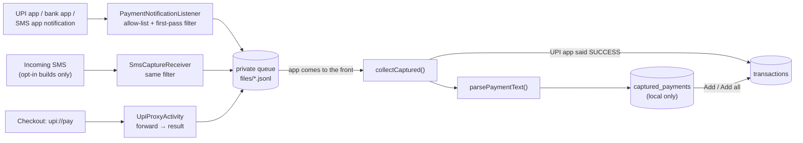

# Automatic logging

How SpentSmart turns payment alerts into transactions without a bank link, an SMS inbox read or a server. All
of it is off until the user turns it on in **Settings → Automatic logging**.



## 1. Sources

### Notification listener

`PaymentNotificationListener` (a `NotificationListenerService`) is bound by Android only after the user grants
notification access. For each posted notification it:

1. Ignores every package not on the allow-list: Google Pay, PhonePe, Paytm, BHIM, CRED, Navi, Jupiter, Slice,
   MobiKwik, Amazon, the major bank apps, and the common SMS apps (Google Messages, Samsung, AOSP/Xiaomi/Oppo MMS,
   OnePlus, Truecaller). Chats, email and social notifications are never read.
2. Does nothing unless the capture switch (a private `SharedPreferences` flag) is on.
3. Runs the shared first-pass filter, `looksLikePayment()`: it must contain an amount (`₹`/`Rs`/`INR`, or SBI's
   "debited by 432.0") and a payment word, and **must not** contain anything code-like (OTP, "one time",
   "verification code", "do not share", CVV, UPI PIN). Messages that fail are dropped before anything is written.
4. Appends `{app, text, at, key}` to the queue, where `at` is the notification's own `when`. Apps re-post old
   notifications (Google Messages re-posts every unread SMS whenever a new one arrives); `when` survives a re-post
   and `postTime` doesn't.

### Incoming SMS (build switch)

`SmsCaptureReceiver` handles `SMS_RECEIVED`, joins multi-part messages per sender, applies the same filter and
writes to the same queue under the source `sms`. It never reads the SMS inbox.

It is **only declared in builds made with `SPENTSMART_SMS_CAPTURE=1`** (the Expo config plugin adds
`RECEIVE_SMS` and the receiver). `RECEIVE_SMS` is one of the permissions Google Play Protect's enhanced fraud
protection blocks for apps installed from a browser or file manager in some regions, so standard builds don't
carry it. In builds that do, turning on Capture payments also asks for the permission.

### UPI proxy (beta)

`UpiProxyActivity` is a `upi://pay` handler declared with `android:enabled="false"`, so no app can see it until the
user turns on **Log payments from other apps**. That calls `setComponentEnabledSetting`. When a checkout
launches it:

1. It validates the URI (`upi://pay…` only) and forwards it **unchanged** to the target app (Google Pay by
   default), or to a chooser that excludes SpentSmart itself.
2. On the UPI app's result, it appends `{uri, resultCode, response, caller, at}` to the proxy queue and returns the
   same result and data to the checkout.

SpentSmart never handles money or the UPI PIN; it only sees the request and the answer.

## 2. The queue

`CaptureStore` keeps an append-only JSON-lines file per source in the app's private `files/` directory: not
readable by other apps, capped at the last 300 entries, synchronised for the listener and receiver threads. The
JavaScript side drains (reads and deletes) it whenever the app comes to the front. Turning capture off deletes
anything not yet drained.

## 3. Parsing

`packages/finance/src/capture/payment-text.ts`, pure and unit-tested:

| Step | Detail |
|---|---|
| Reject | OTPs, collect requests ("has requested ₹500"), upcoming or failed debits, mandates, reminders, promos/cashback |
| Direction | The earliest of debit words (debited, spent, paid, sent, withdrawn) and credit words (credited, received, refund). "X sent you ₹500" is a credit |
| Amount | First currency amount not preceded by "balance"/"limit" (card SMS end with "Avl Lmt Rs 50000") |
| Payee | "paid/sent ₹N to X", "to VPA x@y", "at X", ICICI's "; X credited", "by NEFT X" for credits, `Info: UPI/P2M/…/X`; shouted names title-cased; account and card fragments rejected |
| Reference | `Ref`, `Refno`, `UPI:`, `RRN` |
| Via | `atm` (becomes a transfer to Cash), `card`, `upi` |

Covered formats: Google Pay, PhonePe and Paytm notifications; HDFC, SBI and ICICI UPI SMS; card spends; NEFT
credits; ATM withdrawals. Tests: `payment-text.test.ts`.

## 4. De-duplication

One payment often shows up two or three times (the UPI app's notification, the bank's SMS, re-posts). In
`captured.add()`:

1. **Fingerprint.** A cyrb53 hash of source + normalised text, unique in the table. The exact same message is never
   a new payment, however often it's re-posted. Only the hash is stored, never the text.
2. **Twin.** Same reference, or same direction and amount within 10 minutes → merged; details missing from one
   are filled from the other.
3. **Already recorded.** A transaction of the same type and amount within 10 minutes (for example, paid through
   SpentSmart, or added by hand) → skipped.
4. A **proxied success** creates the transaction directly (`verified_by = upi_result`) and settles any waiting twin.

Handled rows are kept 60 days so late duplicates are still recognised, then deleted.

## 5. The inbox

`app/capture-inbox.tsx`: each item shows its source, time and a guessed category (quick add's rules plus the user's
own history), with **Add**, **Ignore** and **Add all**. Home shows a banner while anything waits.

## 6. Android 15+ and SMS: a real limit

On Android 15 and later, the system (Android System Intelligence) can mark notifications as *sensitive*. Listeners
without the system-only `RECEIVE_SENSITIVE_NOTIFICATIONS` permission then receive the text **"Sensitive
notification content hidden"** instead. On the Android 16 emulator, every SMS notification arrived that way,
including ones with no code in them. So:

- **UPI app notifications** are the primary capture source. They aren't SMS, but this needs confirming on each phone.
- **Bank SMS via notifications** works or doesn't depending on the phone's system intelligence service.
- The **SMS receiver build** is the fallback where they are hidden.

For testing only, adb can grant the permission:
`adb shell appops set com.ujjwaljain.spentsmart RECEIVE_SENSITIVE_NOTIFICATIONS allow`, then toggle the listener off
and on (`adb shell cmd notification disallow_listener …` / `allow_listener …`).

## 7. Testing on the emulator

```bash
# grant access the same way a user does (Settings → Automatic logging → Capture payments), or:
adb shell cmd notification allow_listener com.ujjwaljain.spentsmart/expo.modules.upiintent.PaymentNotificationListener

# send bank SMS to the emulator; Google Messages posts a notification for each
adb emu sms send 5551001 "Sent Rs.432.00 From HDFC Bank A/C *1234 To ZEPTO On 22/11/26 Ref 432112345678"
adb emu sms send 5551002 "432112 is your OTP for txn of Rs 999 at AMAZON. Do not share it"   # must never appear

# inspect the queue (debug builds only)
adb shell run-as com.ujjwaljain.spentsmart cat files/capture_queue.jsonl
```

Proxy results can be simulated by writing a line to `files/proxy_queue.jsonl` with `run-as`, the way the activity
does, and bringing the app to the front.

What was verified this way: OTP and collect-request SMS never reach the queue, a failed payment is rejected, the
SMS and notification for one payment merge, an existing transaction isn't offered again, ignored items don't
return, turning capture off empties the queue, re-posts add nothing, and a proxied success is logged.
